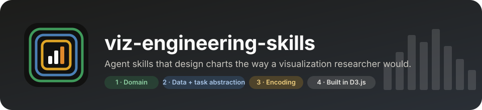
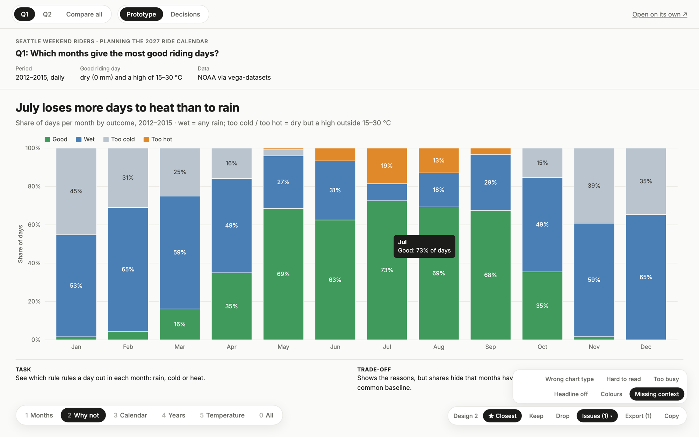
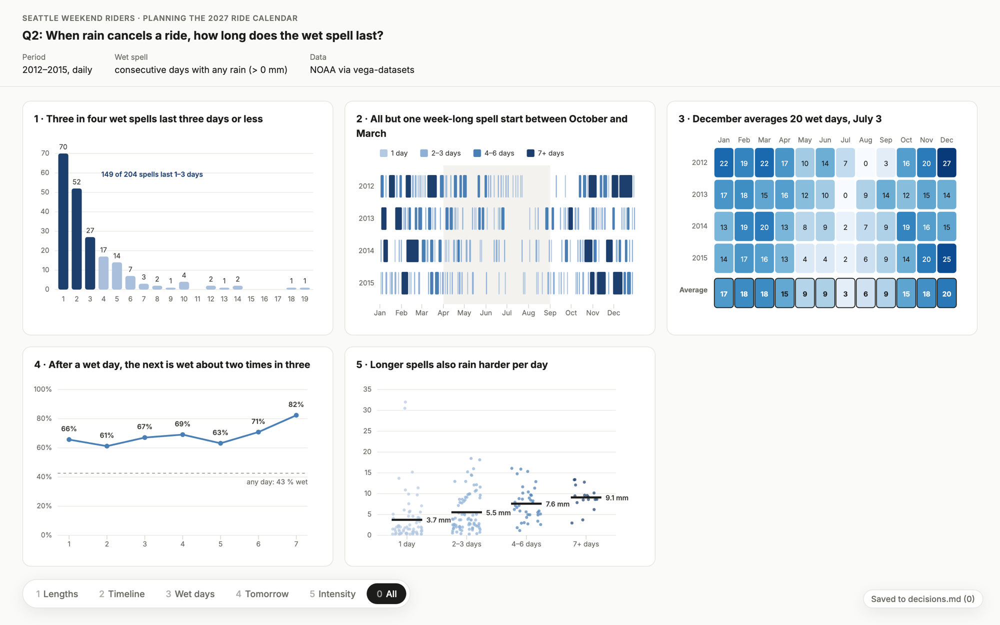
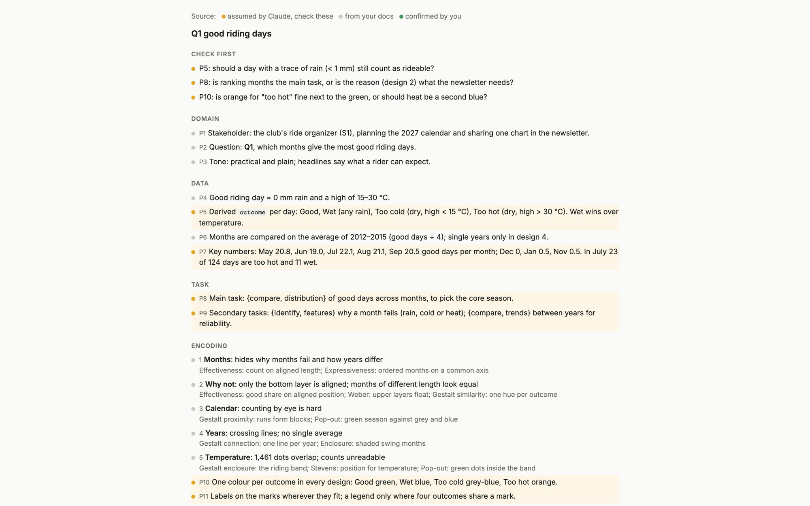
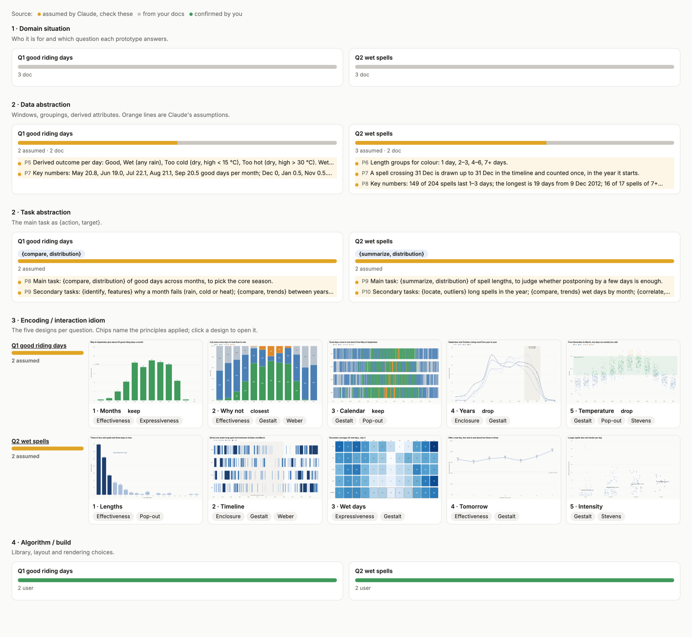
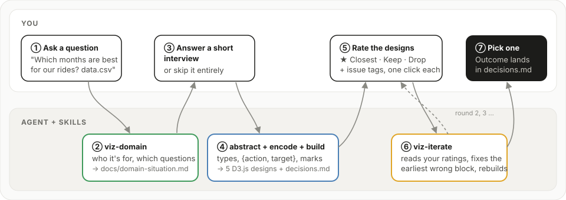
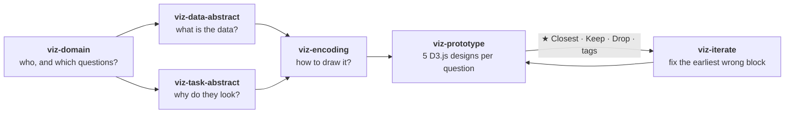

<p align="center">
  
</p>

<p align="center">
  <a href="LICENSE"></a>
  <a href=".claude-plugin/plugin.json"></a>
  <a href="https://d3js.org"></a>
  <a href="https://agentskills.io"></a>
  <a href="#claude-code-plugin"></a>
  <a href="https://www.cs.ubc.ca/~tmm/vadbook/"></a>
</p>

<p align="center">
  <a href="#see-it-in-action">Example</a> ·
  <a href="#how-it-works">How it works</a> ·
  <a href="#skills">Skills</a> ·
  <a href="#install">Install</a> ·
  <a href="#use">Use</a>
</p>

---

Most AI-made charts start with "which chart type?". These skills start where a visualization researcher starts: **who is the chart for, what do they need to find out, and what kind of data is this?** Only then do they choose marks, channels and colours. Then they build **five genuinely different, near-finished D3.js designs** for you to react to.

The method is Tamara Munzner's nested model from *Visualization Analysis and Design*. The skills are plain `SKILL.md` folders, so they work in Claude Code, Codex, Cursor, Gemini CLI, GitHub Copilot, OpenCode and any other agent that reads [Agent Skills](https://agentskills.io).

<p align="center">
  
  <br><sub>One of five D3.js designs for one question. The pill at the bottom right records your rating, with no server: the page is a plain HTML file.</sub>
</p>

## See it in action

The full output of one run lives in [`examples/seattle-rides`](examples/seattle-rides). It uses real data: NOAA daily weather for Seattle, 2012–2015, 1,461 days. The scenario is made up:

> *A volunteer plans the weekend rides of a small Seattle cycling club. Rides keep getting rained off. Before fixing next year's dates, they ask: **"Which months give the most good riding days? And when rain cancels a ride, how long does it last?"***

**1 · Domain:** `viz-domain` turns that into two answerable questions with exact definitions, for example *good riding day = no rain at all and a high of 15–30 °C*. Without a definition like that, every chart would count differently. → [`docs/domain-situation.md`](examples/seattle-rides/docs/domain-situation.md)

**2 · Data and task:** every column gets a type and the derived data gets a name, such as an `outcome` per day (Good, Wet, Too cold, Too hot) and 204 *wet spells*. Each question becomes an abstract task: Q1 is **{compare, distribution}** of good days across months. → [`docs/data-abstraction.md`](examples/seattle-rides/docs/data-abstraction.md)

**3 · Five designs per question:** they differ in mark, in which attribute gets the strongest channel and in arrangement, not just in styling. Each design gets a headline checked against the data and a caption with its task and trade-off.

<p align="center">
  
  <br><sub>Q2, all five answers at once: <i>three in four wet spells last three days or less</i>, but <i>longer spells also rain harder per day</i>.</sub>
</p>

**4 · Every decision written down:** `decisions.md` records each choice and where it came from: your docs, **assumed** by the agent, or confirmed by you. The overview page lists the assumptions first, so you only check what the agent guessed.

<table>
  <tr>
    <td width="50%"></td>
    <td width="50%"></td>
  </tr>
  <tr>
    <td><sub><b>decisions.html</b>: what to check first, then every decision by block</sub></td>
    <td><sub><b>compare.html</b>: all questions across Munzner's blocks, with the principles each design applies</sub></td>
  </tr>
</table>

**5 · Rate, then iterate:** click ★ Closest, Keep or Drop and add issue tags. Your clicks stay in the browser. **Export** saves them as a JSON file for the agent to read, and **Copy** puts them on the clipboard as table rows to paste into the chat. Then say "2 is closest but needs context", and `viz-iterate` traces each tag to the block it belongs to and rebuilds from there.

To open the example, clone the repo and open the hub file. No server or install is needed:

```bash
git clone https://github.com/JoaZaech/viz-engineering-skills
open viz-engineering-skills/examples/seattle-rides/prototypes/index.html   # xdg-open on Linux, start on Windows
```

## How it works

<p align="center">
  
</p>

Munzner's model nests four levels of design, and a mistake at an outer level can't be fixed at an inner one. A chart that "looks wrong" is often a misread task or a mistyped attribute, not a colour problem. So `viz-iterate` doesn't restyle. It finds the **earliest block** that's wrong, fixes it, and re-runs every block after it.



### Why D3.js

Every prototype is hand-drawn SVG in **[D3.js v7](https://d3js.org)**: D3 scales, axes, shapes and data joins, and no chart templates. That's what lets five designs really differ. They can put labels on the marks instead of in a legend, place reference lines and shaded periods exactly where the data puts them, and follow the encoding rules (aligned position for magnitudes, colour only for categories or a diverging sign) without fighting a library's defaults. Each design is one `draw(el, small)` function, so the same code renders the full view, the overview grid and the comparison thumbnails. The pages are self-contained HTML with the data inlined and D3 pinned from a CDN, with no build step.

## Skills

| Skill | Block | What it does |
|---|---|---|
| [`viz-domain`](skills/viz-domain) | 1 · Domain situation | Interviews you about stakeholders, their questions and the data; writes `docs/domain-situation.md`. |
| [`viz-data-abstract`](skills/viz-data-abstract) | 2 · Data abstraction (*What?*) | Types every attribute (categorical, ordinal, quantitative), dataset type, keys and derived attributes; writes `docs/data-abstraction.md`. |
| [`viz-task-abstract`](skills/viz-task-abstract) | 2 · Task abstraction (*Why?*) | Rewrites each domain question as an abstract `{action, target}` task. |
| [`viz-encoding`](skills/viz-encoding) | 3 · Visual encoding (*How?*) | Picks marks and channels using expressiveness and effectiveness, Gestalt, Stevens and Weber. |
| [`viz-prototype`](skills/viz-prototype) | All blocks, autonomously | Builds 5 genuinely different, near-finished **D3.js** designs per question, a `decisions.md` recording every choice, and a local feedback loop that writes your ratings into it. |
| [`viz-iterate`](skills/viz-iterate) | Any block | Reworks an existing chart: reads the prototypes, decisions and ratings, finds the earliest block a problem touches, and re-runs it and every block after it. |

Typical flow: `viz-domain` → `viz-data-abstract` → `viz-task-abstract` → `viz-encoding`. Or jump straight to `viz-prototype` to see options first, then `viz-iterate` until it works.

## Install

### Any agent (npx)

With the open [skills](https://github.com/vercel-labs/skills) CLI, which installs into Claude Code, Codex, Cursor, Gemini CLI, Copilot, OpenCode and others:

```bash
npx skills add JoaZaech/viz-engineering-skills
```

It asks which agents to install into, and whether to install for the project or globally. **Install all six skills:** they link to each other's reference files (for example, `viz-prototype` reads `viz-domain` and `viz-encoding`), so one skill installed on its own has broken links.

### Claude Code plugin

```
/plugin marketplace add JoaZaech/viz-engineering-skills
/plugin install viz-engineering-skills@viz-engineering-skills
```

### Manually

Copy the folders in [`skills/`](skills) into your agent's skills folder:

```bash
git clone https://github.com/JoaZaech/viz-engineering-skills
cp -r viz-engineering-skills/skills/* ~/.claude/skills/      # Claude Code (or .claude/skills/ in a project)
cp -r viz-engineering-skills/skills/* .agents/skills/        # Codex and other agents that read .agents/skills
```

For claude.ai or the Claude desktop app, zip each skill folder and upload it under Settings → Capabilities → Skills.

## Use

Ask in plain language; the agent picks the skill from its description:

| You say | Skill |
|---|---|
| "Who is this chart for and what should it answer?" | `viz-domain` |
| "What kind of data is `data.csv`?" | `viz-data-abstract` |
| "Show me some options for visualizing Q2" | `viz-prototype` |
| "Design 3 is close but too busy, improve it" | `viz-iterate` |

Or call a skill by name, for example `/viz-prototype` in Claude Code.

## Requirements

- **Python 3** with the [`markdown`](https://pypi.org/project/Markdown/) package (`pip install markdown`). The agent uses it to build `viz-prototype`'s overview pages; you never run it yourself.
- **No server.** Every page is a self-contained HTML file you open from disk. Feedback stays in your browser until you export or copy it.
- Prototype pages load **D3.js 7.9.0** and the Inter font from a CDN, so viewing them needs an internet connection. Your data stays inlined in the local page.
- The other skills need nothing beyond the agent.

## Credits

The method and vocabulary follow Tamara Munzner, *Visualization Analysis and Design*, A K Peters/CRC Press, 2014. The figures in `skills/*/assets/` are taken or adapted from that book, its lecture material and other visualization literature (Roth's visual variables, Stevens' and Weber's laws), and remain the property of their authors. They're included for reference and attribution, not under this repository's MIT license. See the [book's page](https://www.cs.ubc.ca/~tmm/vadbook/) for terms of use.

The example uses Seattle weather data from NOAA as distributed in [vega-datasets](https://github.com/vega/vega-datasets). The cycling club in it is made up.

## License

MIT for the skill text and code, see [LICENSE](LICENSE). Figures: see Credits.
