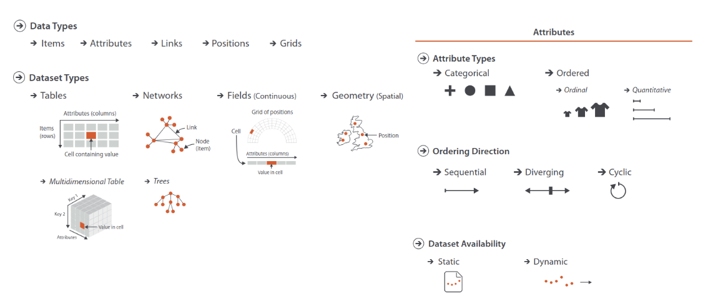
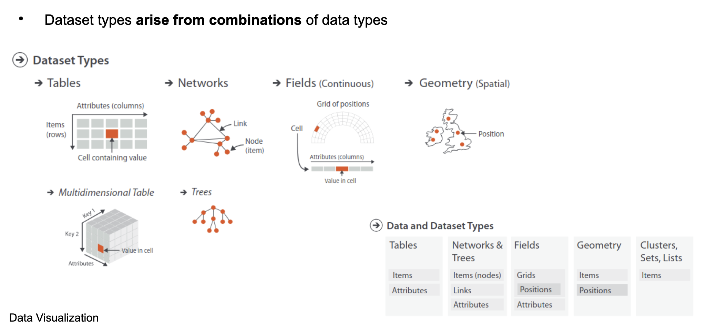

# Data Types and Semantics

The vocabulary for answering **"What?"** (data abstraction): what the items and attributes are, and what kind of dataset they form.

## Contents

1. [Core terms](#1-core-terms): item, attribute
2. [Attribute types](#2-attribute-types): categorical, ordinal, quantitative
3. [Ordering direction](#3-ordering-direction): sequential, diverging, cyclic
4. [Data types](#4-data-types): items, attributes, links, positions, grids
5. [Dataset types](#5-dataset-types): tables, networks, fields, geometry, and the data types that make up each
6. [Dataset availability](#6-dataset-availability): static, dynamic
7. [Attribute descriptors](#7-attribute-descriptors): key, data model, unit / range, source
8. [From raw to visualized data](#8-from-raw-to-visualized-data): transformation, derived, dropped, data issues and their handling

Visual summaries (the tables below transcribe their content):
- [summary_data_types.png](../assets/summary_data_types.png): data types, dataset types, attribute types, ordering direction, dataset availability
- [summary_dataset_types.png](../assets/summary_dataset_types.png): dataset types and the data types each one is built from

---

## 1. Core terms

- **Item**: an individual entity; a discrete unit. Examples: a row in a table, a node in a network, a city or country in geometry.
- **Attribute**: a property of an item that can be measured, observed or logged. Example: a column in a table.

## 2. Attribute types

| Type | Ordered? | Meaning | Example |
|---|---|---|---|
| **Categorical** | No | Distinct groups with no inherent order | Shapes: + ● ■ ▲ |
| **Ordinal** | Yes | Ordered, but differences are not meaningful quantities | Shirt sizes S, M, L |
| **Quantitative** | Yes | Ordered and arithmetic is meaningful | Lengths |

Ordinal and quantitative attributes together are **ordered** data. Ordered data also has an [ordering direction](#3-ordering-direction).

## 3. Ordering direction

Applies only to ordered attributes ([ordinal or quantitative](#2-attribute-types)).

- **Sequential**: a homogeneous range from a minimum to a maximum.
- **Diverging**: two sequences that meet at a common zero point.
- **Cyclic**: values wrap around back to the start point.

## 4. Data types

The five building blocks of any dataset:

- **Items**: see [Core terms](#1-core-terms).
- **Attributes**: see [Core terms](#1-core-terms).
- **Links**: relationships between items, as in a graph.
- **Positions**: points in 2D or 3D space, usually latitude/longitude or x/y/z.
- **Grids**: a strategy for sampling continuous data. A grid defines its *geometry* (where the cells are) and its *topology* (how neighboring cells are connected).

## 5. Dataset types

Dataset types arise from combinations of the [data types](#4-data-types).

| Dataset type | Built from | Notes |
|---|---|---|
| **Tables** | Items, Attributes | Items are rows, attributes are columns, each cell holds a value. Variant: **multidimensional table**, where several keys index a cell. |
| **Networks & Trees** | Items (nodes), Links, Attributes | Nodes connected by links. A **tree** is a hierarchical network. |
| **Fields** (continuous) | Grids, Positions, Attributes | A grid of positions; each cell holds attribute values. |
| **Geometry** (spatial) | Items, Positions | Items with spatial positions, e.g. points on a map. |
| **Clusters, Sets, Lists** | Items | Groupings of items. |

## 6. Dataset availability

- **Static**: the whole dataset is available at once (e.g. a file).
- **Dynamic**: data arrives over time as a stream.

## 7. Attribute descriptors

Recorded per attribute in the data abstraction, alongside its [attribute type](#2-attribute-types).

- **Key**: an attribute (or combination) that uniquely identifies an item. Unambiguous when uniqueness follows from its meaning (e.g. an ID), not just from this snapshot. Simple (one attribute), compound (several attributes together), or implicit (row index). Always check uniqueness on the full data and record the duplicate count.
- **Data model**: how values are stored (int, float, string, bool, date string). Not the same as attribute type: a ZIP code stored as int is categorical.
- **Unit / range**: physical unit (km, kW), format (dd.mm.yyyy), or reference system (WGS84); none if unitless. Plus the range, which replaces cardinality: min–max for quantitative attributes, the ordered levels for ordinal ones, the number of levels for categorical ones.
- **Source**: where a fact about an attribute comes from: D (inferred from the data) or M (stated in the metadata/documentation).

## 8. From raw to visualized data

- **Transformation**: changing the dataset type, e.g. aggregating a table of trips into a network of station-to-station links.
- **Derived attribute**: an attribute computed from raw ones, recorded with its formula or procedure and the raw attributes it uses (e.g. `duration = end_time - start_time`, aggregated per hour of day).
- **Dropped attribute**: a raw attribute that is not used, recorded with one reason (constant, redundant, not needed for any question, mostly missing).
- **Data issue**: a key duplicate, implausible or impossible value, missing value (with its encoding: empty, `NA`, `-99` …), or inconsistent unit or number format. Each issue is handled in one of four ways:
  - **Filter**: remove the affected items.
  - **Impute**: replace the value with an estimate, and record the method.
  - **Flag**: keep the item and mark it with an attribute such as `is_suspect`.
  - **Keep and show**: keep the item as is and make it visible in the visualization (e.g. a "missing" category).
- **Open question**: something the documentation does not answer, recorded with the best guess currently in use.
