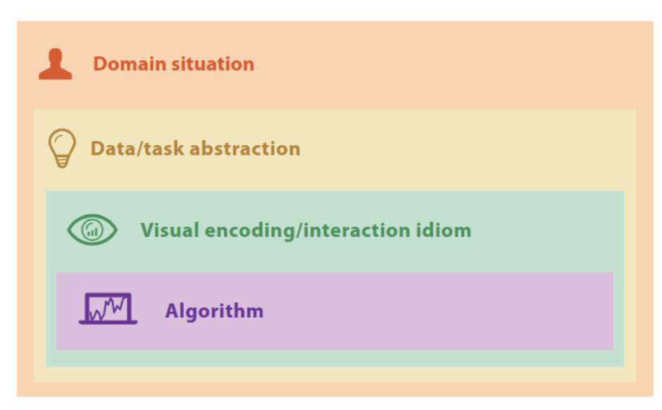

# Visualization Blocks

A **block** is a concrete design decision at one level of the hierarchy below. A wrong choice at any level propagates to every level nested inside it (threat: the design can be wrong at any level).

Tamara Munzner process in general cuts three questions: 
1. What? (Data abstraction)
2. Why? (Task abstraction)
3. How? (Idiom and Visual encoding)

## Hierarchy

Four nested blocks. Each inner block is a subset of the block immediately surrounding it. Work outside-in.

1. [Domain situation](#1-domain-situation)
   1. [Data/task abstraction](#2-datatask-abstraction)
      1. [Visual encoding/interaction idiom](#3-visual-encodinginteraction-idiom)
         1. [Algorithm](#4-algorithm)

## Where am I?

Each block has a skill. Find the skill you are running, do only that block's work, then hand off to the next.

| Block | Skill | Answers | Output | Next |
|---|---|---|---|---|
| [1. Domain situation](#1-domain-situation) | `viz-domain` | Who? What do they need? | `docs/domain-situation.md` | `viz-data-abstract` |
| [2. Data/task abstraction](#2-datatask-abstraction) | `viz-data-abstract` (data part) | What? | `docs/data-abstraction.md` | `viz-task-abstract` |
| [2. Data/task abstraction](#2-datatask-abstraction) | `viz-task-abstract` (task part) | Why? | `docs/task-abstraction.md` | `viz-encoding` |
| [3. Visual encoding/interaction idiom](#3-visual-encodinginteraction-idiom) | `viz-encoding` | How? | | algorithm |
| [4. Algorithm](#4-algorithm) | none yet | How to render? | | |

A topic that belongs to an outer block, but was never settled, sends you back to that block's skill. A topic that belongs to an inner block is deferred: record it, don't decide it.

## Validating a block

Each block can be analyzed separately, in two ways:

- **Immediate validation**: validate as soon as the decision is made.
- **Downstream validation**: requires the remaining inner levels to be built first.

---

## 1. Domain situation

**Decides:** who the visualization is for and what they need.

- Who are the stakeholders?
- What are their questions and tasks?
- What is their data? What conventions do they use, and how can the data be transformed or used?

**Outcome:**
- A detailed set of the users' questions and tasks.
- A collection of data that is understood in detail.

This block later links tasks → data → design, so the result is useful, trustworthy and deployable.

**Skill:** `viz-domain` · Reference: [domain-situation-template.md](domain-situation-template.md)

**Feeds into:** [Data/task abstraction](#2-datatask-abstraction)

## 2. Data/task abstraction

**Decides:** how domain-specific questions and data translate into abstract, domain-independent terms.

- **Task blocks are identified.** Domain tasks sometimes map directly to abstract visualization tasks (e.g. *compare*, *summarize*).
- **Data blocks are designed.** Sometimes it must be checked whether an abstract task is suitable for the domain situation.

**Skill:** `viz-data-abstract` for the data ("What?") · Reference: [data-types.md](../../viz-data-abstract/references/data-types.md). `viz-task-abstract` for the task ("Why?"). Data and tasks inform each other: a task can need a derived attribute, and the data limits which tasks are possible.

**Inside:** [Domain situation](#1-domain-situation) · **Feeds into:** [Visual encoding/interaction idiom](#3-visual-encodinginteraction-idiom)

## 3. Visual encoding/interaction idiom

**Decides:** the visualization idiom. Each block represents one idiom.

- **Visual encoding**: what users see.
- **Interaction**: how users can manipulate what they see.

**Outcome:** design decisions on visual encoding and interaction.

**Skill:** `viz-encoding` · Reference: [marks-channels.md](../../viz-encoding/references/marks-channels.md)

**Inside:** [Data/task abstraction](#2-datatask-abstraction) · **Feeds into:** [Algorithm](#4-algorithm)

## 4. Algorithm

**Decides:** how to render the visualization. Each block represents one rendering design decision.

- Keep idiom design separate from implementation.
- Some idioms may not be feasible at the algorithm level; if so, revisit [Visual encoding/interaction idiom](#3-visual-encodinginteraction-idiom).

**Inside:** [Visual encoding/interaction idiom](#3-visual-encodinginteraction-idiom)
