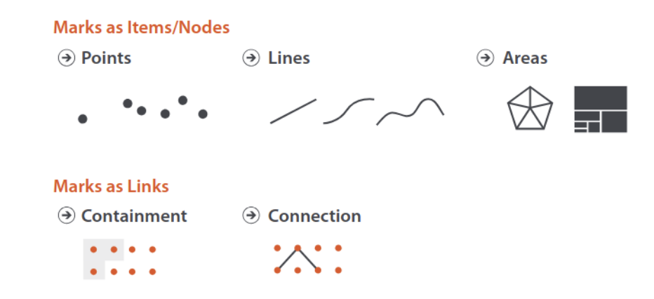
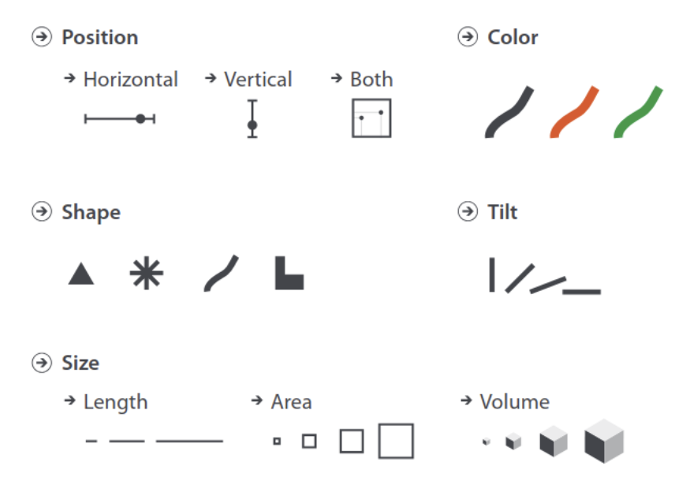
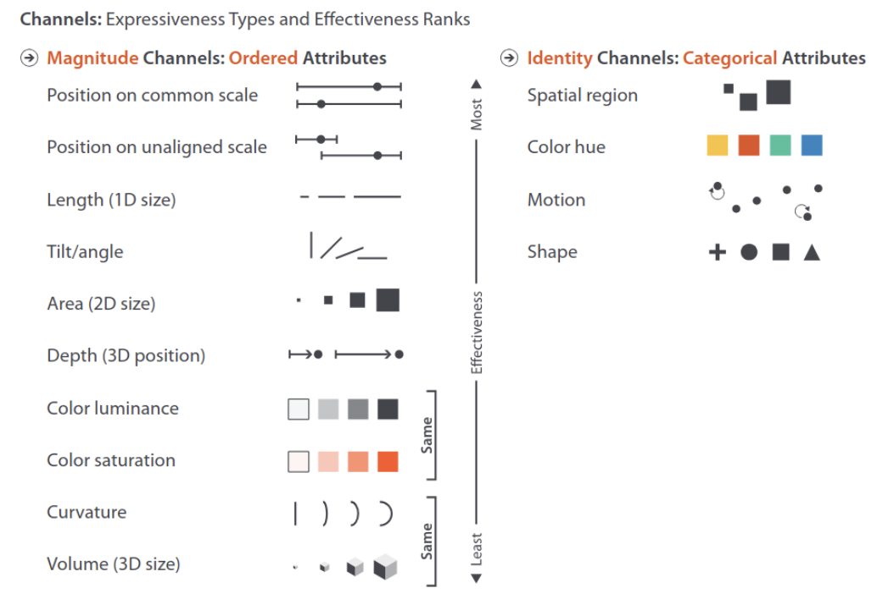

# Marks and Channels

The vocabulary for answering **"How?"** (visual encoding): which marks represent the data, and which channels control how those marks look.

## Contents

1. [Marks](#1-marks): geometric primitives, items vs. links
2. [Channels](#2-channels): position, color, shape, tilt, size
3. [Channel types](#3-channel-types): identity vs. magnitude
4. [Channel effectiveness ranking](#4-channel-effectiveness-ranking): most to least effective per channel type
5. [Expressiveness and effectiveness principles](#5-expressiveness-and-effectiveness-principles): the two rules every encoding must follow

Visual summaries (the tables below transcribe their content):
- [marks.png](../assets/marks.png): marks as items/nodes and marks as links
- [channels.png](../assets/channels.png): the main channels that control a mark's appearance
- [channel-effectiveness.png](../assets/channel-effectiveness.png): magnitude and identity channels, ranked by effectiveness

---

## 1. Marks

A **mark** is a basic geometric element (e.g. a point, line or rectangle) that depicts an item or a link.

### Geometric primitives

| Primitive | Dimensions | Example |
|---|---|---|
| **Point** | 0D | Dot in a scatterplot |
| **Line** | 1D | Line in a line chart |
| **Area** | 2D | Bar, treemap cell, country on a map |
| **Volume** | 3D | Rare in practice |

### Mark types

| Type | Depicts | Forms |
|---|---|---|
| **Item mark** | An item (a row, a node) | Point, line, area |
| **Containment** (link mark) | A relationship shown by enclosing items | Nested areas, e.g. treemap |
| **Connection** (link mark) | A relationship shown by a line between items | Edges in a node-link diagram |

## 2. Channels

A **channel** controls the appearance of marks. Which channel is effective depends on the [attribute type](../../viz-data-abstract/references/data-types.md#2-attribute-types) it encodes.

| Channel | Variants |
|---|---|
| **Position** | Horizontal, vertical, both |
| **Color** | Hue, saturation, luminance |
| **Shape** | Symbols, glyphs |
| **Tilt** | Angle of a line |
| **Size** | Length (1D), area (2D), volume (3D) |

- **Double encoding**: using two channels for the same attribute (e.g. color and shape for one category). Makes the attribute easier to read; uses up a channel.
- **Not every channel fits every mark.** A mark that already uses a dimension cannot also vary along it: shape or size cannot encode an area mark (its shape and size are the data), and a line can vary in thickness but not in length, because its length is already set by position.

## 3. Channel types

| Type | Answers | Fits attribute type |
|---|---|---|
| **Identity** | *What* or *where* something is | [Categorical](../../viz-data-abstract/references/data-types.md#2-attribute-types) |
| **Magnitude** | *How much* of something there is | [Ordered](../../viz-data-abstract/references/data-types.md#2-attribute-types) (ordinal and quantitative) |

## 4. Channel effectiveness ranking

Ranked from most to least effective. Rows marked *same* are about equally effective.

| Rank | Magnitude channels (ordered attributes) | Identity channels (categorical attributes) |
|---|---|---|
| 1 | Position on a common scale | Spatial region |
| 2 | Position on an unaligned scale | Color hue |
| 3 | Length (1D size) | Motion |
| 4 | Tilt / angle | Shape |
| 5 | Area (2D size) | |
| 6 | Depth (3D position) | |
| 7 | Color luminance *(same as 8)* | |
| 8 | Color saturation *(same as 7)* | |
| 9 | Curvature *(same as 10)* | |
| 10 | Volume (3D size) *(same as 9)* | |

## 5. Expressiveness and effectiveness principles

The two rules every visual encoding must follow.

> **Important:** these two principles are central to this project. Check every encoding decision against both before moving on.

### Expressiveness principle

The encoding expresses all of, and only, the information in the dataset.

- Don't encode [categorical](../../viz-data-abstract/references/data-types.md#2-attribute-types) data with [magnitude channels](#3-channel-types): it implies an order that doesn't exist.
- Don't encode [ordered](../../viz-data-abstract/references/data-types.md#2-attribute-types) data with [identity channels](#3-channel-types): it hides the order that does exist.

### Effectiveness principle

The importance of an attribute matches the salience of its channel.

- Use the most effective channel (see the [ranking](#4-channel-effectiveness-ranking)) for the most important attribute.
- Less important attributes get the less effective channels.
