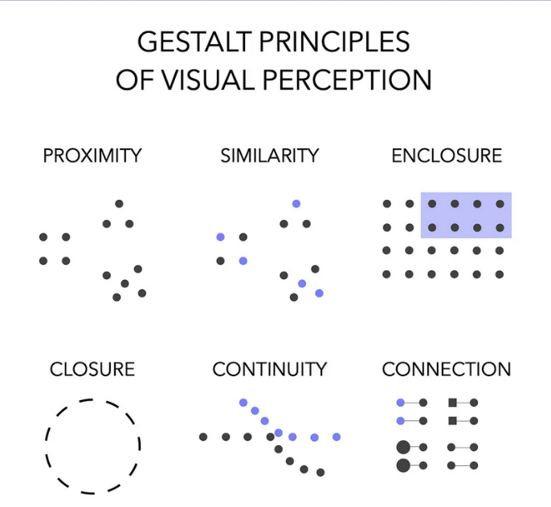
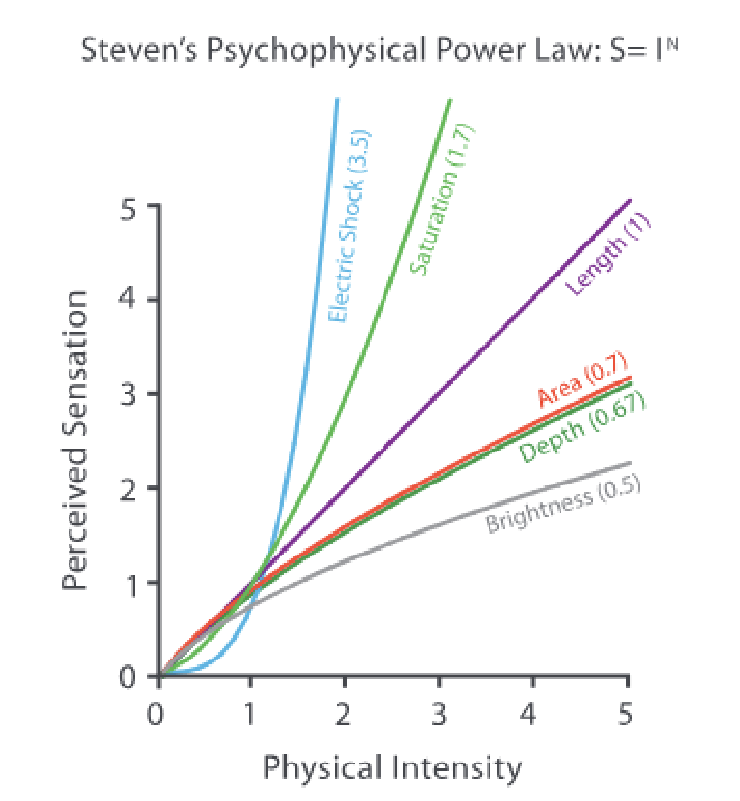
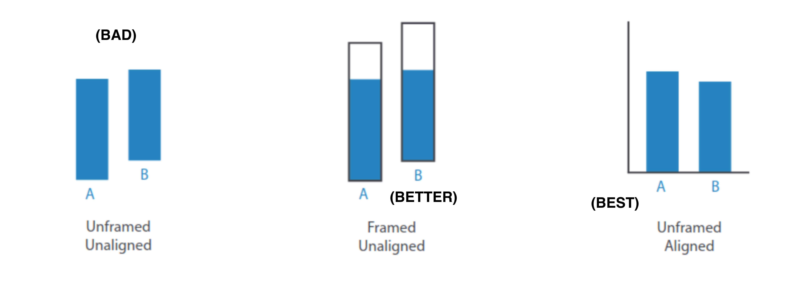

# Perceptual Principles

Why some encodings work and others mislead. Use this file to justify the channel choices from [marks-channels.md](marks-channels.md): the ranking there follows from the laws here.

## Contents

1. [Gestalt principles](#1-gestalt-principles): how the eye groups marks
2. [Stevens' power law](#2-stevens-power-law): how big a value *looks* (accuracy)
3. [Weber's law](#3-webers-law): when two values can be *told apart* (discriminability)
4. [How Stevens and Weber connect](#4-how-stevens-and-weber-connect)
5. [Design checklist](#5-design-checklist): rules to apply when encoding

Visual summaries:
- [gestalt-principles.png](../assets/gestalt-principles.png): proximity, similarity, enclosure, closure, continuity, connection
- [stephens-law.png](../assets/stephens-law.png): perceived vs. physical intensity per channel
- [webers-law-example.png](../assets/webers-law-example.png): unaligned vs. framed vs. aligned bars

---

## 1. Gestalt principles

German psychologists studied these laws in the 1920s. "Gestalt" means shape or form. The laws describe how perception organizes visual input into **groups** before any value is read.

- When two or more laws apply and **agree**, the grouping gets stronger.
- When they **disagree**, one law wins, and which one is not fully predictable. Do not rely on a conflict resolving in your favour.
- Use them on purpose: make the groups the viewer should see match the groups in the data, and avoid accidental groupings.

| Principle | Perceived as a group when marks… | Use in vis |
|---|---|---|
| **Proximity** | are close together | Place items that should be compared next to each other (grouped bars, small multiples spacing) |
| **Similarity** | share colour, shape or size | Colour or shape encodes category: same hue = same group (see identity channels in [marks-channels.md](marks-channels.md#3-channel-types)) |
| **Enclosure** | share a bounded region | Background bands, boxes or shaded regions mark a subset (highlighted period, cluster hull) |
| **Closure** | form an incomplete shape the eye completes | Dashed or partial outlines still read as one shape, so gridlines and axes can stay light |
| **Continuity** | lie along a smooth path | Line charts and ordered axes; crossing lines are followed by smoothness, not by colour |
| **Connection** | are linked by a line | Strongest grouping: lines in line charts, links in node-link diagrams, dot-and-line (dumbbell) plots |

Strength: connection and enclosure usually override proximity and similarity. For example, a line joining two distant points groups them even when closer points have the same colour.

## 2. Stevens' power law

**S = k · Iⁿ**: perceived sensation S grows as a power of physical intensity I (k is a constant, n depends on the stimulus).

| Exponent | Effect | Channels |
|---|---|---|
| **n < 1** compressed | Increases are **underestimated** | Area (~0.7), depth (~0.67), brightness (~0.5) |
| **n ≈ 1** linear | Close to accurate | Length (~1.0) |
| **n > 1** expanded | Increases are **overestimated** | Saturation (~1.7) |

**For vis:** this is why length ranks above area for magnitude. Bars read accurately, while bubbles make differences look smaller than they are. A circle with twice the area looks only about 2^0.7 ≈ 1.6× as big.

## 3. Weber's law

**ΔI / I = k**: the just noticeable difference (JND, ΔI) is a fixed fraction k of the starting magnitude I. Perception is based on **relative**, not absolute, judgement. Adding 1 cm to a 2 cm line is easy to see. Adding 1 cm to a 50 cm line is not.

Implications for accuracy and discriminability:
- **Big things hide small differences.** Two long bars with a small gap are hard to tell apart. Two short bars with the same absolute gap are easy.
- **Aligned beats separated.** Comparisons are more precise for aligned objects than for separated ones. Cleveland & McGill's framed bars turn one big comparison into a small one: you compare the short unfilled gaps, not the long filled bars. Gridlines and reference lines work the same way. This is one reason position on a common scale ranks first.

  
- **Colour depends on its surround.** The same grey or hue looks different on different backgrounds (simultaneous contrast). So colour is a poor channel for exact magnitude, and colour legends and marks need a consistent background.
- **Chart types can be ranked with it.** Perceived correlation in scatterplots follows Weber's law: the JND for r shrinks as |r| approaches 1. Fitting Weber models to several chart types lets them be ranked by precision. A pure Weber model fits individual charts only approximately, so treat fitted k values as rough.

## 4. How Stevens and Weber connect

| | Weber | Stevens |
|---|---|---|
| Question | When can I *tell* two values apart? (discriminability) | How big does a value *look*? (accuracy, bias) |
| Form | ΔI / I = k | S = k · Iⁿ |
| Shared idea | Ratios, not absolute differences | Ratios, not absolute differences |

Under Stevens, a stimulus ratio I₂/I₁ is perceived as (I₂/I₁)ⁿ. So a just-noticeable step of (1 + k) in the stimulus looks like a step of about (1 + n·k):
- **Length (n ≈ 1):** a 10% longer bar looks about 10% longer. There is little bias, and precision is limited only by the Weber JND.
- **Area (n ≈ 0.7):** a 10% bigger circle looks about 7% bigger (1.1^0.7 ≈ 1.07). The compression shrinks perceived differences and pushes small real differences below the JND.
- **Brightness (n ≈ 0.5):** compression is even stronger, so lightness is poor for fine magnitude differences.

**Combined rule:** for magnitudes that must be compared, use a channel with **n ≈ 1** (length or position, unbiased by Stevens) and **align it to a common baseline** (to keep relative differences large, by Weber).

Background: Fechner integrated Weber's law into a logarithmic law, S = k · log I. Stevens replaced it with the power law, which also covers expanded channels (n > 1).

## 5. Design checklist

Apply these rules when choosing an encoding:

1. **Magnitude → position on a common scale, then length.** Avoid area, volume, brightness or saturation for values the viewer must compare precisely (Stevens). See the ranking in [marks-channels.md](marks-channels.md#4-channel-effectiveness-ranking).
2. **If you must use area** (bubbles, treemaps), scale the **area**, not the radius, to the value. Label key values, because the viewer will still underestimate differences.
3. **Align and add references.** Use a shared baseline, gridlines or reference lines so comparisons stay small and local (Weber).
4. **Make groups match the data.** Use proximity, similarity, enclosure or connection for real groups, and check that no accidental grouping appears (Gestalt).
5. **Do not let grouping cues conflict.** If colour says one grouping and position says another, the outcome is unpredictable. Make them agree.
6. **Keep colour backgrounds consistent.** Do not judge magnitude from colour placed on varying surrounds.

For discriminability, separability and pop-out, see [viz-effectiveness.md](viz-effectiveness.md). To test whether an encoding actually reads as intended, continue with the `viz-prototype` and `viz-iterate` skills.
