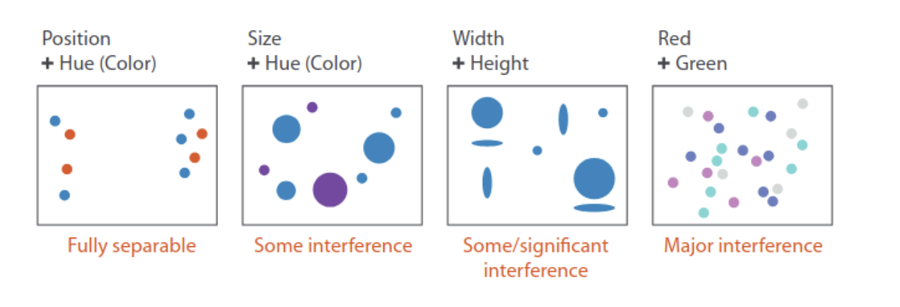

# Effectiveness of Visual Encodings

The [effectiveness principle](marks-channels.md#5-expressiveness-and-effectiveness-principles) says the most important attribute gets the most effective channel. This file explains **what makes a channel effective** and how to check an encoding against it, following Munzner (*Visualization Analysis and Design*, 2014, ch. 5).

Munzner measures channel effectiveness with five criteria:

| Criterion | Question it answers | Covered in |
|---|---|---|
| **Accuracy** | How close is the perceived value to the real value? | [perceptual-principles.md §2 Stevens' power law](perceptual-principles.md#2-stevens-power-law) |
| **Discriminability** | How many different values can the viewer tell apart? | [§1 below](#1-discriminability) |
| **Separability** | Can two channels on the same mark be read independently? | [§2 below](#2-separability) |
| **Popout** | Does one item stand out immediately, without searching? | [§3 below](#3-preattentive-processing-and-popout) |
| **Grouping** | Which marks does the eye see as belonging together? | [perceptual-principles.md §1 Gestalt principles](perceptual-principles.md#1-gestalt-principles) |

Underneath all five: perception is **relative**, not absolute ([Weber's law](perceptual-principles.md#3-webers-law)). The [channel ranking](marks-channels.md#4-channel-effectiveness-ranking) is the combined result of these criteria.

## Contents

1. [Discriminability](#1-discriminability): how many distinguishable steps a channel has
2. [Separability](#2-separability): separable vs. integral channel pairs
3. [Preattentive processing and popout](#3-preattentive-processing-and-popout): what is seen before it is understood
4. [Effectiveness checklist](#4-effectiveness-checklist): apply to every encoding

Visual summary:
- [example_seperability.png](../assets/example_seperability.png): channel pairs from fully separable to major interference

---

## 1. Discriminability

**Definition:** a channel is discriminable when the viewer can perceive the differences between the values it shows. Every channel has a limited number of **bins** (distinguishable steps); the [Weber JND](perceptual-principles.md#3-webers-law) sets how fine those steps can be.

**Rule:** the number of distinct values in the attribute must fit the number of bins the channel supports. If it does not, the encoding stops being effective, even if the channel ranks well.

Typical questions per channel:

| Channel | Discriminability question | Practical limit (rule of thumb) |
|---|---|---|
| **Position** | Can viewers see small positional differences? | Very many steps; best channel for fine differences |
| **Length** | Can viewers see a small difference between two bars? | Many steps if aligned to a common baseline |
| **Color hue** | Can viewers tell red from orange? | About 6–12 categories |
| **Color luminance / saturation** | Can viewers tell neighbouring shades apart? | Only a few steps (about 3–5), and they depend on the background |
| **Size (area)** | Can viewers see differences in circle size? | Few steps; differences are also underestimated ([Stevens](perceptual-principles.md#2-stevens-power-law)) |
| **Shape** | Can viewers tell the symbols apart? | A handful of clearly different symbols |
| **Line width** | Can viewers tell line thicknesses apart? | Only a few steps |

**When the attribute has more values than the channel has bins:**
- **Switch channel** to a more discriminable one (e.g. from hue to position or to a label).
- **Group or bin** the values (e.g. merge rare categories into "Other", put quantities into ranges). Binning rounds every value to its bin, so **accuracy is lost**: say so in the design rationale.
- **Remove** values the [task](../../viz-task-abstract/SKILL.md) does not need.

## 2. Separability

**Definition:** when two channels encode two attributes on the same mark, they can interfere. Channel pairs lie on a **continuum from separable to integral**:

- **Separable:** the viewer can read each channel on its own, and selectively attend to one while ignoring the other.
- **Integral:** the viewer perceives the two channels as **one combined property** and cannot easily pull them apart.

| Channel pair | Position on continuum | What the viewer actually sees |
|---|---|---|
| **Position + hue** | Fully separable | Where it is and what colour it is, independently |
| **Size + hue** | Some interference | Mostly separable, but hue is harder to judge on small marks |
| **Width + height** | Some / significant interference | One combined property: the **area** or **aspect ratio** of the shape, not two values |
| **Red + green** (two colour components) | Major interference | One combined property: a single **hue**, not two values |

**Rules:**
- To show **two independent attributes** on one mark, choose a **separable** pair (position plus anything is the safest).
- Use an **integral** pair only when the viewer should perceive the **combination** as one thing (e.g. width × height read as area when area is the value of interest).
- Never assume two channels can be decoded separately just because they are technically different channels: check the pair against this continuum.

## 3. Preattentive processing and popout

**Preattentive processing:** some visual properties are detected **immediately**, at the sensory level rather than the cognitive level, before conscious attention. They are *seen* rather than *understood*, and require no serial search.

### Popout

**Definition:** a distinct item **pops out** when it differs from all surrounding items in one preattentive channel, e.g. one red dot among blue dots, or one tilted line among vertical ones.

Properties:
- **Speed is independent of the number of items.** Finding the red dot among 10 or 1,000 blue dots takes about the same time. This is the test for preattentive processing.
- **Works on one channel at a time.** Many channels support popout (hue, shape, size, tilt, curvature, motion), but not all equally strongly, and some features do not pop out at all (e.g. a pair of parallel lines among non-parallel ones).
- **Combining channels weakens it.** A target defined by a *conjunction* of two channels (e.g. "the red circle" among red squares and blue circles) usually requires serial search: speed then depends on the number of items. With three or more channels, popout is effectively impossible.

**Rules:**
- Use popout to **direct attention** to the item or region the [task](../../viz-task-abstract/SKILL.md) is about (an outlier, the selected item, the current value).
- Make the target differ in **exactly one channel**, and keep that channel constant for all other marks.
- **Reserve** the popout channel: if hue already encodes a category, use a different channel to highlight (or desaturate everything else).
- Pop out **one thing**, or very few. If everything is highlighted, nothing pops out.

## 4. Effectiveness checklist

Apply after the [expressiveness check](marks-channels.md#expressiveness-principle) and for every attribute → channel decision:

1. **Rank:** is the most important attribute on the most effective channel for its type? ([ranking](marks-channels.md#4-channel-effectiveness-ranking))
2. **Accuracy:** if values must be compared precisely, is the channel position or length, aligned to a common baseline? ([Stevens](perceptual-principles.md#2-stevens-power-law), [Weber](perceptual-principles.md#3-webers-law))
3. **Discriminability:** does the number of distinct values fit the channel's bins? If not, switch channel, bin (and note the lost accuracy) or filter. ([§1](#1-discriminability))
4. **Separability:** are any two attributes on the same mark encoded with an integral pair? If so, change one to a separable channel. ([§2](#2-separability))
5. **Popout:** does the item the task needs to find differ from the rest in exactly one channel? ([§3](#3-preattentive-processing-and-popout))
6. **Grouping:** do the visual groups match the groups in the data, with no accidental or conflicting grouping? ([Gestalt](perceptual-principles.md#1-gestalt-principles))

Record which criterion drove each channel choice in the design rationale. To test whether the encoding actually reads as intended, continue with the `viz-prototype` and `viz-iterate` skills.
